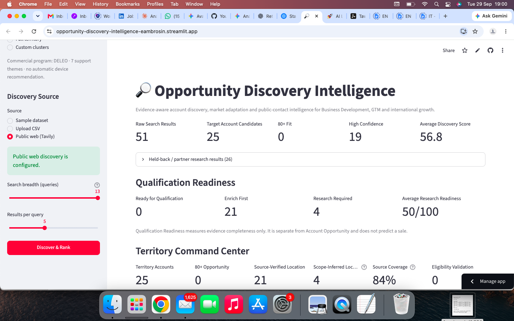
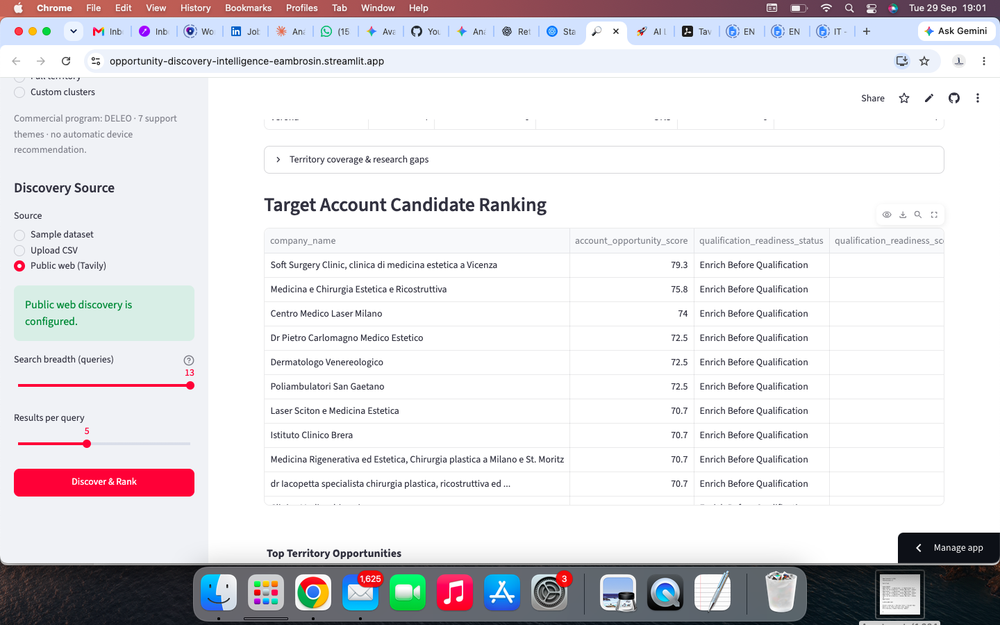
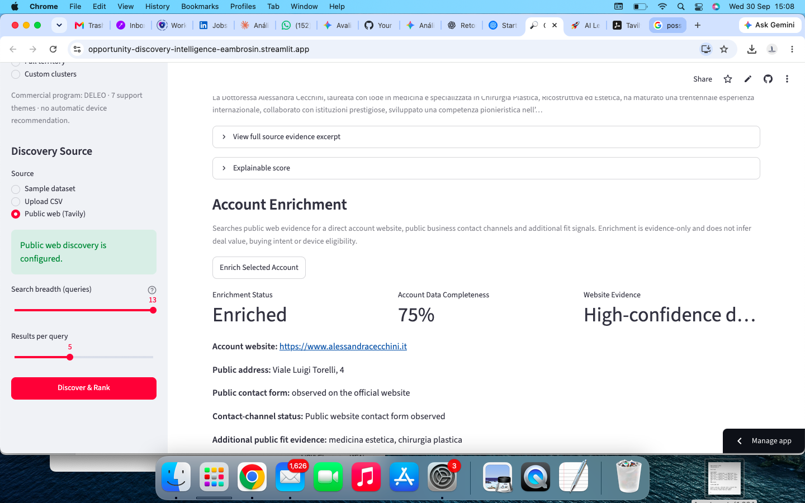
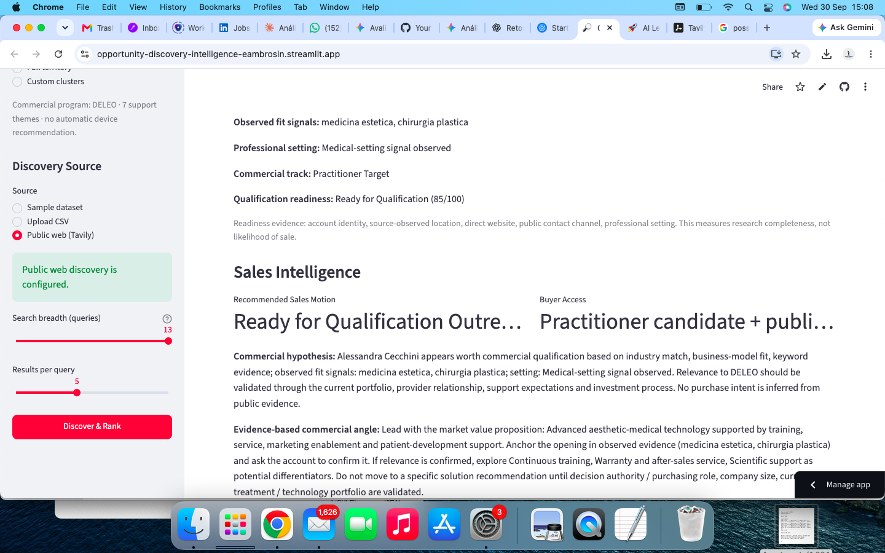

# Opportunity Discovery Intelligence

### Commercial Mandate | Evidence-Aware Public-Web Discovery | Buyer & Partner Handoffs

[](https://opportunity-discovery-intelligence-eambrosin.streamlit.app/)


[](https://github.com/Eambrosin/opportunity-discovery-intelligence/actions/workflows/ci.yml)

A practical Commercial Intelligence application for executing international Business Development mandates: define the commercial corridor, discover buyers and partners, preserve public evidence, separate **opportunity attractiveness** from **research completeness**, organize trade-feasibility questions and hand qualification context downstream.

> **Commercial logic first. Public evidence remains traceable. Unknown information stays unknown until validated.**

**[Launch the live application](https://opportunity-discovery-intelligence-eambrosin.streamlit.app/)**

---

## Business Problem

Market discovery often produces a noisy list of search results rather than a usable commercial queue.

Typical problems include:

- directories, editorial pages and vendors mixed with real target accounts
- incomplete or inferred location data presented as fact
- attractive accounts treated as qualification-ready before enough evidence exists
- homonyms or weak LinkedIn matches entering outreach
- research context lost when an account moves downstream

Opportunity Discovery Intelligence turns that research into an explainable workflow.

---


## Ambrosin Commercial Mandate Workspace

IDENTIFY is the entry point of a shared **Commercial Mandate Workspace** used across IDENTIFY, PRIORITIZE, PARTNER and ENGAGE.

The live apps can use a private Supabase-backed workspace. A mandate is created once, saved centrally and opened in another module through an opaque **mandate_id** carried in the URL. After **Private Workspace Access** is granted, the receiving app resolves the canonical mandate automatically.

The workspace preserves:

- client / represented company
- commercial corridor
- product / solution
- buyer / partner focus
- target market and territories
- route-to-market hypothesis
- value proposition and constraints
- Trade & Market Entry Feasibility status
- workflow stage and recommended progression

Portable Commercial Mandate JSON remains available as a fallback and interchange format.

The current navigation is role-aware:

- **Buyers** → IDENTIFY → PRIORITIZE → ENGAGE
- **Partners** → IDENTIFY → PARTNER → ENGAGE
- **Buyers + Partners** → IDENTIFY can feed both PRIORITIZE and PARTNER before execution in ENGAGE

---


## Commercial Workflow

```text
COMMERCIAL MANDATE
        ↓
TARGET MARKET / COUNTERPARTY PROFILE
        ↓
TRADE & MARKET-ENTRY FEASIBILITY
        ↓
PUBLIC-WEB DISCOVERY
        ↓
ACCOUNT / PARTNER IDENTITY SCREENING
        ↓
ACCOUNT OPPORTUNITY
        +
QUALIFICATION READINESS
        ↓
ACCOUNT ENRICHMENT
        +
PUBLIC DECISION-MAKER / CONTACT VALIDATION
        ↓
BUYER CANDIDATES ───────→ PRIORITIZE ───────→ ENGAGE
        │
        └──────────────→ PARTNER CANDIDATES → PARTNER → ENGAGE
```

The system deliberately keeps different questions separate:

- **Account Opportunity:** How attractive does this account appear from observed evidence?
- **Qualification Readiness:** Is there enough verified information to work the account efficiently?
- **Counterparty Role:** Buyer, route-to-market partner, execution / technical partner, or still to validate?
- **Buyer / Partner Access:** Is there a usable public path to the relevant people?
- **Sales Motion:** Research, enrich, qualify, partner-evaluate or engage?

A high-opportunity search result is not automatically treated as a buyer, partner or sales-ready lead.

---

## Commercial Mandate & Market Entry Context

IDENTIFY can now begin with a shared **Commercial Mandate** rather than an isolated search.

The mandate can be exported as a **portable JSON file** and reused across IDENTIFY, PRIORITIZE, PARTNER and ENGAGE.

The mandate can preserve:

- represented company / client
- origin → target commercial corridor
- product or solution
- commercial objective
- buyer vs partner discovery focus
- target buyer types
- target partner types
- route-to-market hypothesis
- value proposition
- known constraints
- HS / CN / NCM references when available
- target territories and working languages
- measurable success criteria

For cross-border work, the app also carries an explicit **Trade & Market Entry Feasibility** layer with verification states for tariff scenarios, preferential treatment, Ex-Tarifário relevance, rules of origin, import requirements, technical requirements and after-sales needs.

These are workflow states, not automatic legal, customs, tariff or technical conclusions.

The application mirrors three practical market-entry questions:

1. **Who could buy / partner?**
2. **Can the offer compete?**
3. **What must be prepared before execution?**

---

## Current Interface

The current live interface is organized around one commercial workflow:

1. **Commercial Mandate** — create, select or restore the mandate from the shared workspace.
2. **Trade & Market Entry Feasibility** — keep tariff, origin, NCM, technical and after-sales questions explicit.
3. **Target Market Profile** — select a preset or customize the target industry, business models, fit signals, exclusions, decision-maker roles and search archetypes.
4. **Discovery Source** — use a sample file, upload CSV or run public-web discovery with Tavily.
5. **Discovery Diagnostics** — inspect generated queries, raw results, target-account candidates, confidence and research readiness.
6. **Account Intelligence Workspace** — review evidence, enrich the account, validate public contact paths and assess the next commercial motion.
7. **Execution Handoff** — export buyer candidates to PRIORITIZE, partner candidates to PARTNER and qualified execution context to ENGAGE.

Public-web queries can use the product defined in the Commercial Mandate and localized market terms. Editorial / research pages are held back from commercial execution rather than treated as target accounts.

---

## Product Preview

### 1. Discovery Executive Summary



Raw search volume is separated into target-account candidates and held-back research results, with Qualification Readiness and territory context visible from the start.

### 2. Target Account Ranking



Account candidates are ranked with explainable opportunity logic while directories, vendors and research-only results stay outside the commercial shortlist.

### 3. Account Enrichment & Qualification



The selected account is enriched with direct-website and public-contact evidence while research completeness remains separate from account attractiveness.

### 4. Sales Intelligence & Qualification Context



The workflow converts observed evidence into Sales Motion, Buyer Access, qualification questions, evidence gaps and next-best action without inferring purchase intent.

---

## Core Capabilities

- shared Commercial Mandate context
- shared Ambrosin Mandate Workspace navigation
- buyer / partner discovery focus
- buyer / route-to-market / execution-partner role separation
- portable Commercial Mandate JSON
- trade and market-entry feasibility states
- configurable target-market profiles
- Public Web / Tavily discovery
- explainable Discovery and Account Opportunity scoring
- target-account vs research/partner segregation
- territory and location evidence handling
- Qualification Readiness scoring
- selective Account Enrichment
- direct website and public-contact evidence
- sector-specific operational / technology evidence tracking
- public decision-maker / professional-profile validation
- homonym filtering using identity + role + location
- deterministic Sales Intelligence
- qualification questions and evidence gaps
- buyer handoff to PRIORITIZE
- partner handoff to PARTNER
- execution handoff to ENGAGE
- optional evidence-aware AI brief
- automated test suite and GitHub Actions CI

---

## Evidence-Aware Design

The application distinguishes between:

**Observed fact**  
Supported by the current evidence set.

**Commercial interpretation**  
A deterministic conclusion based on observed inputs.

**Hypothesis / question**  
Potentially relevant but still requiring validation.

**Unknown**  
Information that should not be silently converted into a score or claim.

This is especially important for company size, buying intent, energy consumption, installed equipment, decision authority and technical eligibility.

---

## Sector Demonstrations

The same discovery engine can be configured for different commercial motions without changing its evidence-aware design.

### 1. Fotovoltaico — Aziende ad Alto Consumo Energetico

The default preset now focuses on **commercial and industrial end customers** that may have a strong economic case for on-site photovoltaic generation.

Typical target categories include:

- industrial and manufacturing plants
- food & beverage production
- cold storage and refrigeration
- logistics centers and warehouses
- supermarkets / GDO
- hotels and resorts
- private hospitals and healthcare facilities
- data centers
- paper, ceramic, glass, metals, foundries, chemicals and plastics
- agro-industrial operations and greenhouses

The objective is to discover **potential photovoltaic buyers**, not photovoltaic suppliers.

Installers, photovoltaic distributors, wholesalers and EPC providers are explicitly treated as non-target signals for this preset.

Public operational evidence such as production facilities, refrigeration, industrial processes, warehouses or other energy-intensive activities can increase commercial relevance. However, the application does **not** claim verified energy consumption.

Actual electricity load, load profile, roof / land availability, self-consumption potential, technical feasibility and investment timing remain qualification questions.

Possible account states include:

- **C&I Energy Consumer Target** — public operational signals support deeper commercial qualification
- **Potential C&I Energy Consumer — Validate Load** — company identity is usable, but energy demand and photovoltaic feasibility remain unverified

### 2. Macchinari & Attrezzature — Brasile

A dedicated Europe → Brazil preset supports discovery of Brazilian industrial end users for European machinery and equipment.

The preset is designed to be customized around the actual machine, industrial application and buyer profile. When the Commercial Mandate is switched to **Partners** or **Buyers + Partners**, distributor, sales-agent, integrator and technical-service profiles can be added to the route-to-market search.

### 3. Caffè Specialty — Europa

A Brazil → Europe preset supports discovery of European green-coffee importers, specialty roasters and relevant buyers. Quality, certifications, crop availability, logistics, pricing and actual buyer interest remain qualification items.

### 4. Medicina Estetica

A second preset supports opportunity discovery in the Italian **Medicina Estetica** market.

It includes localized search archetypes, practitioner / clinic classification, public-contact discovery and, where relevant, territory intelligence for Northern Italy.

The default commercial program is generic. Any vendor-specific context must be selected explicitly and is treated as an optional commercial-planning layer rather than as the identity of the application.

The generic engine is not limited to photovoltaic or medical-aesthetics use cases.

---


## IDENTIFY → PRIORITIZE / PARTNER → ENGAGE

IDENTIFY now supports two downstream commercial branches.

**Buyer / end-customer candidates** can be exported to PRIORITIZE with:

- account identity and evidence
- Account Opportunity
- Qualification Readiness
- counterparty role
- Sales Motion
- public-contact context
- qualification questions and evidence gaps
- Commercial Mandate and Trade Feasibility context

**Route-to-market / execution partner candidates** can be moved into PARTNER for structured partner scoring and due diligence.

Accounts that already have sufficient execution context can also be prepared for ENGAGE, but the preferred workflow is to preserve qualification or partner-validation logic before prospect-facing execution.

---


## Demo Flow

A concise current portfolio demonstration:

1. create or load a Commercial Mandate
2. select a target-market preset
3. run **Public web (Tavily)** discovery
4. inspect generated queries and discovery diagnostics
5. separate direct accounts from held-back content / research pages
6. review Account Opportunity and Qualification Readiness
7. enrich a strong account and validate public decision-maker / contact evidence
8. classify the account as buyer, route-to-market partner or execution partner
9. export buyers to PRIORITIZE and partners to PARTNER
10. continue qualified execution in ENGAGE under the same mandate

Full walkthrough: [docs/PORTFOLIO_DEMO.md](docs/PORTFOLIO_DEMO.md)

---


## Architecture

```text
app.py
  ↓
commercial_mandate.py
  ↓
workspace_persistence.py / mandate_workspace.py
  ↓
presets.py / discovery_engine.py
  ↓
web_discovery.py / counterparty_roles.py
  ↓
account_enrichment.py / contact_discovery.py
  ↓
sales_intelligence.py / field_sales_intelligence.py
  ↓
PRIORITIZE / PARTNER / ENGAGE handoffs
```

The application keeps deterministic commercial logic separate from presentation and optional AI assistance. Shared cloud persistence stores mandate context; sensitive workspace access remains protected server-side.

---

## Testing

The repository includes automated tests covering discovery, enrichment, evidence snapshots, contact discovery, territory intelligence, presets and Sales Intelligence.

```bash
python -m pytest -q
```

GitHub Actions runs syntax/import checks and the test suite on pushes and pull requests to `main`.

---

## Running Locally

```bash
git clone https://github.com/Eambrosin/opportunity-discovery-intelligence.git
cd opportunity-discovery-intelligence
pip install -r requirements.txt
streamlit run app.py
```

Public-web discovery requires a Tavily API key. Optional AI evidence briefs require an OpenAI API key.

Secrets should be supplied through environment variables or Streamlit secrets and are excluded from version control.

---


## Current Version

**Main branch — Workspace-enabled Commercial Intelligence**

The tagged **v1.0.0** release established the evidence-aware discovery engine. The current main branch extends that foundation with:

- shared private Commercial Mandate persistence
- automatic `mandate_id` handoff across modules
- buyer / partner branching
- mandate-aware discovery queries
- stronger filtering of editorial / market-research pages
- vertical-neutral field-sales language
- demo-safe separation between sample data and active mandates

[Release Notes for v1.0.0](docs/RELEASE_NOTES_v1.0.0.md)

---

## Documentation

- [Portfolio Demo Walkthrough](docs/PORTFOLIO_DEMO.md)
- [Detailed Technical Reference](docs/TECHNICAL_REFERENCE.md)
- [v1.0.0 Release Notes](docs/RELEASE_NOTES_v1.0.0.md)

---

## Limitations

This is a portfolio and commercial decision-support application, not a production CRM or autonomous sales system.

Current boundaries include:

- no automated outreach sending
- no private-page scraping
- no claim that a public profile is a verified purchasing decision-maker
- no inferred buying intent
- no guarantee that indexed public contact details are current
- human review remains required before commercial use

---

## Portfolio Context

This project is the **IDENTIFY** layer of the broader Commercial Intelligence portfolio:

```text
IDENTIFY → PRIORITIZE → ENGAGE
IDENTIFY / Partner Universe → PARTNER → ENGAGE
```

**Portfolio:** [github.com/Eambrosin](https://github.com/Eambrosin)

---

## Author

**Eduardo Ambrosin**  
International Business Development | Strategic Partnerships | GTM | Commercial Intelligence
